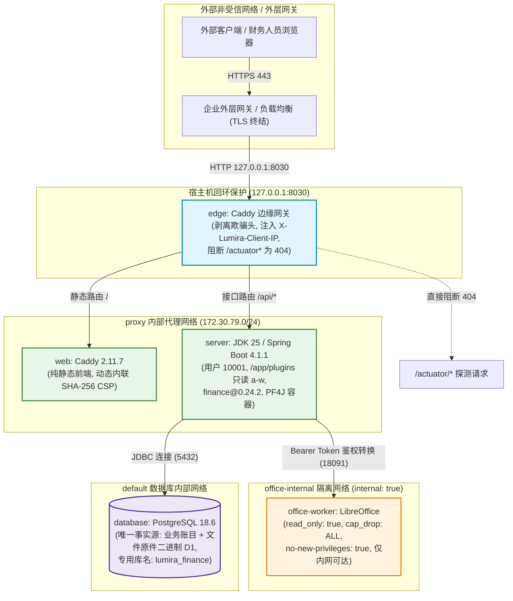

# Lumira Finance 生产部署、升级、容灾演练与运维操作手册

> **适用版本**：`finance@0.24.2`  
> **基座锁死版本**：`platform/lumira-next @ 5dcc378978d57b74ff5ffc1b9b4e34cd8f982d3f`  
> **运行环境基线**：Node 24 LTS · pnpm 10.33.0 · JDK / JRE 25 · PostgreSQL 18.6  
> **适用角色**：DevOps 工程师、SRE 站点可靠性工程师、金融系统发布管理员

---

## 目录

- [1. 生产部署拓扑与隔离边界](#1-生产部署拓扑与隔离边界)
  - [1.1 五容器生产拓扑架构](#11-五容器生产拓扑架构)
  - [1.2 与上游及非生产环境的强制物理隔离](#12-与上游及非生产环境的强制物理隔离)
  - [1.3 二进制原件事务级存储决策（D1 架构）](#13-二进制原件事务级存储决策d1-架构)
- [2. 环境准备与密钥安全托管规范](#2-环境准备与密钥安全托管规范)
  - [2.1 软硬件基础设施基线](#21-软硬件基础设施基线)
  - [2.2 受保护环境变量配置（.env）](#22-受保护环境变量配置env)
  - [2.3 生产核心密钥生成标准](#23-生产核心密钥生成标准)
  - [2.4 密钥与备份分离保管铁律](#24-密钥与备份分离保管铁律)
- [3. 首次生产部署全流程（Day-1 Bootstrap & Hardening）](#3-首次生产部署全流程day-1-bootstrap--hardening)
  - [3.1 核心机制：LUMIRA_PLUGINS_FIXED_GRAPH 两阶段激活](#31-核心机制lumira_plugins_fixed_graph-两阶段激活)
  - [3.2 阶段 A：构建不可变发布镜像](#32-阶段-a构建不可变发布镜像)
  - [3.3 阶段 B：受控初始化窗口（fixed_graph=false）](#33-阶段-b受控初始化窗口fixed_graphfalse)
  - [3.4 阶段 C：稳态生产锁定与就绪验证（fixed_graph=true）](#34-阶段-c稳态生产锁定与就绪验证fixed_graphtrue)
- [4. 保数据版本升级与回滚治理（Day-2 Zero-Data-Loss PRESERVE Upgrade & Rollback）](#4-保数据版本升级与回滚治理day-2-zero-data-loss-preserve-upgrade--rollback)
  - [4.1 升级前强制防线：隔离演练与回滚台账登记](#41-升级前强制防线隔离演练与回滚台账登记)
  - [4.2 路径一：平滑镜像升级（推荐，保持固定图锁定）](#42-路径一平滑镜像升级推荐保持固定图锁定)
  - [4.3 路径二：动态维护窗口升级（PRESERVE 保数据卸载与重绑）](#43-路径二动态维护窗口升级preserve-保数据卸载与重绑)
  - [4.4 基座升级协同（B52 结构克隆换库护栏）](#44-基座升级协同b52-结构克隆换库护栏)
  - [4.5 严格回退边界与应急倒退 SOP](#45-严格回退边界与应急倒退-sop)
- [5. 备份、自动恢复演练与灾难恢复手册（PLT02 / OPS01）](#5-备份自动恢复演练与灾难恢复手册plt02--ops01)
  - [5.1 生产 RPO / RTO 指标与归档要求](#51-生产-rpo--rto-指标与归档要求)
  - [5.2 自动备份与演练工具脚本指南](#52-自动备份与演练工具脚本指南)
  - [5.3 恢复演练 5 大硬指标逐项核验规范](#53-恢复演练-5-大硬指标逐项核验规范)
  - [5.4 真实生产灾难全量恢复 SOP](#54-真实生产灾难全量恢复-sop)
- [6. 可观测性、安全头与日常运维排障](#6-可观测性安全头与日常运维排障)
  - [6.1 X-Request-Id 全链路追踪](#61-x-request-id-全链路追踪)
  - [6.2 内部 Prometheus 指标抓取规范](#62-内部-prometheus-指标抓取规范)
  - [6.3 生产安全响应头体系](#63-生产安全响应头体系)
  - [6.4 关键监控告警阈值清单](#64-关键监控告警阈值清单)
  - [6.5 常见故障速查表（Troubleshooting）](#65-常见故障速查表troubleshooting)
- [7. 生产外部能力与合规诚信边界声明（Mandatory V4 Boundary Disclosures）](#7-生产外部能力与合规诚信边界声明mandatory-v4-boundary-disclosures)

---

## 1. 生产部署拓扑与隔离边界

### 1.1 五容器生产拓扑架构

`lumira-finance` 生产环境基于 Docker Compose 编排体系，采用完全物理与网络隔离的 **5 独立服务容器架构**：

1. **`edge`（边缘反代网关）**：
   - 基于轻量高性能 Caddy 服务器，作为整个财务生产集群对外暴露的唯一 HTTP 反向代理入口。
   - 监听容器内 `8010` 端口，宿主机严格仅绑定本地回环端口 `127.0.0.1:8030`（供企业级外部负载均衡器如 Nginx、Traefik、F5 或云 ALB/CLB 终结 TLS 证书后反向代理，严禁直接公网裸露）。
   - **请求清洗与路径硬拦截**：对 `/actuator/*` 及 `/actuator` 恒定返回 `404` 阻断探测；强行剥离不可信客户端传递的 `-Forwarded`、`-X-Real-IP`；将直连远程客户端真实 IP 固化为 `X-Lumira-Client-IP` 传递给后端（安全响应头由上游 `server` 与 `web` 单一归属下发，避免边缘重复注入）。
2. **`web`（静态资产服务器）**：
   - 基于 Caddy 2.11.7 构建，托管前端单页应用（SPA）静态制品。
   - 宿主机不映射端口，仅在代理网络 `proxy`（固定边缘网段 `172.30.79.0/24`）内部对 `edge` 可达。
   - **动态 CSP 强化**：在镜像构建阶段通过 `scripts/generate-csp.mjs` 提取 `index.html` 内联启动脚本的 SHA-256 哈希，动态生成严格 Content-Security-Policy（`script-src 'self' 'sha256-...'`），彻底剔除 `'unsafe-inline'` 与 `'unsafe-eval'`（样式保留 Ant Design 所需的 `'unsafe-inline'` 折中）。
3. **`server`（财务后端核心引擎）**：
   - 基于 JDK 25 / Spring Boot 4.1.1 与 PF4J 插件系统，运行财务系统业务后端。
   - **最小特权沙箱**：容器内以专属非 root 用户 `10001:10001`（`lumira:lumira`）运行，工作目录为只读 `/app`。
   - **插件目录只读锁定**：镜像构建时固化锁定基座与 `finance@0.24.2` 制品，生成静态审批依赖图 `approved-graph.json`，并执行 `chmod -R a-w /app/plugins`，运行时绝对禁止在插件目录写入或篡改任何二进制。
   - **健康探针**：配置原生 Docker healthcheck，以 10 秒间隔探测 `http://127.0.0.1:8090/actuator/health/readiness`。
4. **`office-worker`（文档转换沙箱）**：
   - 运行无特权只读 LibreOffice 实例，专职处理财务导出文档、凭证报表向 PDF 及版式文件的安全转换。
   - **深度沙箱隔离**：
     - 文件系统只读：`read_only: true`，仅为 `/tmp` 和 `/dev/shm` 挂载临时带大小限制与 `noexec` 标志的 `tmpfs`；
     - 权限剥夺：配置 `cap_drop: ["ALL"]` 移除全部 Linux Capabilities，并设置 `security_opt: ["no-new-privileges:true"]`；
     - 隔离网络：仅挂载内部专属网络 `office-internal`（`internal: true`），物理阻断任何出网访问外网、数据库或前端网络；
     - 请求凭据校验：仅允许来自 `server` 容器且携带合法 `X-Office-Worker-Token` 认证头的内网 HTTP 请求。
5. **`database`（关系型数据库与二进制事实源）**：
   - 运行标准 PostgreSQL 18.6，作为整个财务系统的唯一数据事实源（Source of Truth）。
   - 持久化挂载宿主机受 ACL 保护的数据卷，严格限定仅在受控内部网络中由 `server` 容器访问。



---

### 1.2 与上游及非生产环境的强制物理隔离

为确保金融级系统稳定性，严禁将生产财务环境与上游平台示例或开发/QA 环境共用基础设施。运维配置必须坚守以下三大硬隔离：

1. **专属数据库名隔离**：
   - 生产财务系统的数据库名必须明确命名为 **`lumira_finance`**（或必须显式包含 `finance`，如 `lumira_finance_prod`）。
   - **绝对红线**：严禁复用上游默认数据库名 `lumira_next`，也严禁复用开发/测试数据库 `lumira_qa_finance` 或 `lumira_finance_dev`。`bootstrap-finance-person-directory.mjs` 等运维工具在检测到目标库名为 `lumira_next` 时会主动抛出致命异常并拒绝执行。
2. **专属宿主机端口隔离**：
   - 生产 `edge` 宿主机绑定端口为 **`127.0.0.1:8030`**。
   - 上游 Lumira Next 默认端口为 `8010`，开发/预览工作区常用 `8000` 或 `8020`。生产环境固定使用 `8030`，彻底阻断端口串扰与流量误导。
3. **专属容器网段与命名空间隔离**：
   - 代理桥接网络 `proxy` 固定分配私有子网 **`172.30.79.0/24`**（动态地址池 `172.30.79.128/25`），`edge` 容器固定分配内部 IP `172.30.79.2`。
   - 上游默认使用的是 `172.30.78.0/24`。子网划分完全独立，杜绝跨 Docker 项目网络串包与 ARP 冲突。

---

### 1.3 二进制原件事务级存储决策（D1 架构）

在企业财务系统中，发票电子原件（OFD/XML/PDF）、银行对账单、税务申报回执、进项税认证清单及原始凭证附件是具备法律效力的审计铁证。

传统将文件分散存储在宿主机本地目录或独立对象存储（S3/MinIO）的方案存在致命缺陷：**数据库账表与文件存储无法建立跨系统分布式事务，在故障恢复时极易出现“凭证恢复了但原件文件丢失”，或“原件恢复了但凭证已回滚”的数据脑裂**。

`lumira-finance` 严格落地平台架构决策 **D1（PostgreSQL 原生事务级二进制持久化）**：
- **存储载体**：所有新上传的凭证附件与系统生成的电子档案切片统一写入 PostgreSQL 18 的 `platform_file_blob_chunk`（平台文件分块表），所有财务电子原件及税务回执字节统一写入 `plugin_finance_original`（财务原件实体表）。
- **宿主机目录降级**：宿主机卷 `/data/files` 仅作为历史版本迁移只读只拉取的历史兜底，新业务写入完全走数据库分块存储。
- **运维与容灾价值**：**备份 PostgreSQL 数据库即等于全量备份了整套财务账簿与全量电子原件二进制字节**。无论是日常 `pg_dump -Fc` 逻辑快照，还是基于 WAL 物理归档的 PITR 恢复，均具备单事务引擎的毫秒级时序一致性，从根源上消除了双轨备份撕裂风险。

---

## 2. 环境准备与密钥安全托管规范

### 2.1 软硬件基础设施基线

| 组件 | 最低规格要求 | 生产推荐基线 | 角色与用途说明 |
|---|---|---|---|
| **CPU 架构** | 4 核 x86_64 / aarch64 | 8 核以上高性能计算核心 | Spring Boot 启动、Flyway 迁移与报表计算 |
| **系统内存** | 8 GB 物理内存 | 16 GB ~ 32 GB ECC 内存 | Java 堆分配 4G，PostgreSQL 共享缓冲与排序内存 |
| **磁盘存储** | 100 GB SSD (IOPS ≥ 3000) | 500 GB NVMe SSD 镜像阵列 | 承载账表索引与 D1 二进制原件增长 |
| **操作系统** | Linux 内核 ≥ 5.15 | Ubuntu 24.04 LTS / Debian 12 / RHEL 9 | 支撑非特权用户与 Docker 安全命名空间 |
| **容器引擎** | Docker Engine 26.0+ | Docker Engine 27.x + Compose v2.26+ | 支撑沙箱属性与 fail-closed 环境变量解析 |
| **宿主机运维** | Node.js 24 LTS | Node.js 24.x + PostgreSQL 18 客户端工具 | 执行备份演练、发布编排及守卫检测脚本 |

---

### 2.2 受保护环境变量配置（.env）

生产部署配置基于代码库根目录提供的模板 `.env.example` 衍生。

**权限严控**：
在生产宿主机部署目录下创建 `.env` 文件后，必须立即赋予仅当前运维属主可读写的权限：
```bash
cp .env.example .env
chmod 0600 .env
```
严禁使用全局可读权限（如 `0644` 或 `0777`），严禁将带真实密码的 `.env` 提交至任何 Git 分支或配置中心非密公开节点。

---

### 2.3 生产核心密钥生成标准

必须使用真随机发生器在隔离的生产运维机器上生成高熵凭据，严禁使用任何默认口令或有规律的字符。标准生成命令如下：

#### 1. 数据库主口令（`LUMIRA_DB_PASSWORD`）
```bash
openssl rand -hex 32
```
*要求：64 位十六进制高熵字符，配置于 PostgreSQL 容器与后端 JDBC 密码中。*

#### 2. 初始管理员引导口令（`LUMIRA_BOOTSTRAP_PASSWORD`）
```bash
node -e "console.log(crypto.randomBytes(24).toString('base64url') + '@F1n')"
```
*要求：长度 ≥ 16 位，包含大写字母、小写字母、数字及特殊符号的高熵口令，仅用于首次引导启动，后续通过改密流程废弃。*

#### 3. 文档转换沙箱服务令牌（`LUMIRA_OFFICE_WORKER_TOKEN`）
```bash
openssl rand -hex 32
```
*要求：64 位十六进制密钥，用于后端 `server` 调用 `office-worker` 时的服务间认证。*

#### 4. 平台数据加密主密钥（`LUMIRA_SECRET_KEYS`）
```bash
echo "primary=$(openssl rand -base64 32)"
```
*输出格式必须为 `primary=<base64-32bytes>`。支持未来轮换时以逗号追加历史解密密钥（如 `primary=<new_base64>,secondary=<old_base64>`）。用于数据库中第三方网关、邮件/短信配置与 AI 访问凭据的 AES-GCM 加密存储。*

#### 5. Prometheus 监控鉴权令牌（`LUMIRA_METRICS_TOKEN`）
```bash
openssl rand -hex 24
```
*要求：长度必须 ≥ 32 字符。当未设置该环境变量时，后端 `/actuator/prometheus` 端点自动静默返回 404；正确设置后要求客户端在请求头提供 `Authorization: Bearer <token>` 常量时间比对。*

---

### 2.4 密钥与备份分离保管铁律

> [!CAUTION]
> **金融系统核心凭据保管铁律（Secret Custody Separation Invariant）**：
>
> 1. `LUMIRA_SECRET_KEYS` 负责加密数据库中存储的 SMTP 邮件凭据、短信网关凭据、税务申报连接凭据、银行通信前置机密钥及大模型访问密钥等高敏感资产。
> 2. **绝对禁止将 `LUMIRA_SECRET_KEYS` 与数据库备份文件（`.dump`、WAL 物理归档、演练快照）保存在同一介质、同一云存储桶、同一宿主机目录或同一凭据管理库中！**
> 3. **两难困境警示**：
>    - 若丢失主密钥，即使数据库完整恢复，所有受保护的外部凭据与连接鉴权将永久损毁且不可逆还原；
>    - 若主密钥与数据库备份同处一处，一旦数据备份发生误拷贝、内部泄露或审计外流，攻击者即可直接解密全部外部通信通道凭据，使应用层加密彻底形同虚设。
> 4. **生产实践规范**：`LUMIRA_SECRET_KEYS` 必须托管于独立企业级硬件安全模块（HSM）、云原生 KMS 或经过双人复核权限管控的独立 Vault 保险库；备份文件单独经由专用 GPG 公钥加密后流转至异地冷存储。

---

## 3. 首次生产部署全流程（Day-1 Bootstrap & Hardening）

### 3.1 核心机制：LUMIRA_PLUGINS_FIXED_GRAPH 两阶段激活

在生产环境中进行 `lumira-finance` 发布治理，必须深刻理解底座 `PluginRuntime` 与固定图模式（Fixed Graph Mode）的底层设计：

1. **空库引导局限性**：
   上游平台在全新 PostgreSQL 数据库上完成 `B52__platform_initialization.sql` 基础建表后，后端的 `PluginRuntime` 在未传入预置业务图定义的 bootstrap 阶段，仅会自动检测并安装内核级的三大基础组件：`feedback`（用户反馈）、`localization`（国际化语言包）、`sensitive-words`（敏感词过滤）。上游底座**绝对不会**在空库时自动推断并挂载未知的业务领域插件（如 `finance` 财务系统）。
2. **固定图模式的防御性阻断**：
   生产安全基线要求必须开启固定图模式 `LUMIRA_PLUGINS_FIXED_GRAPH=true`。在该模式下，后端会强制锁定插件清单，任何通过 HTTP REST API 进行的在线插件安装、升级、卸载或启停调用均会被直接拦截并抛出：
   ```http
   HTTP/1.1 409 Conflict
   Content-Type: application/json

   { "error": "pluginFixedGraph", "message": "Plugin lifecycle operations are forbidden in fixed graph mode" }
   ```
3. **两阶段激活规范流程**：
   因此，首次上线必须严格遵循受控三阶段：**阶段 A（不可变镜像构建）** $\rightarrow$ **阶段 B（单节点受控初始化窗口 `fixed_graph=false`）** $\rightarrow$ **阶段 C（稳态锁定与全服务拉起 `fixed_graph=true`）**。

---

### 3.2 阶段 A：构建不可变发布镜像

在构建服务器或部署宿主机上，基于声明式的 Dockerfile 构建生产镜像：

```bash
# 1. 确保 Git 子模块已完全检出至锁定提交
git submodule update --init --recursive

# 2. 执行不可变镜像构建
docker compose -f deploy/compose.yml build
```

**镜像构建内部安全固化行为**：
- `server` 镜像拉取 JDK 25 基座与 Node 24 构建环境，使用 `pnpm@10.33.0` 安装前端与后端依赖；
- 将 `plugins/finance` 完整源码与元数据覆盖入构建树，生成精确匹配的 `approved-graph.json` 依赖批准图；
- 编译并封装 `finance@0.24.2` 插件制品到 `/app/plugins/finance`；
- 执行 `chmod -R a-w /app/plugins` 将整套插件目录打为全文件只读锁定；
- 声明默认容器运行身份为非 root `USER 10001:10001`。

---

### 3.3 阶段 B：受控初始化窗口（fixed_graph=false）

在此阶段，开启一次性受控维护窗口，完成数据库 B52 平台初始化、初始管理员改密、`finance@0.24.2` 插件安装与迁移（V1–V37）、以及自然人种子目录初始化。

#### Step 1: 临时开启初始化窗口模式
在 `.env` 中临时设置：
```properties
LUMIRA_PLUGINS_FIXED_GRAPH=false
```

#### Step 2: 启动单实例初始化拓扑
```bash
docker compose -f deploy/compose.yml up -d
```
*此时后端首次连接 PostgreSQL 空库，自动执行 `B52__platform_initialization.sql`，建立基础表结构，并创建待改密的 `admin` 账户。*

#### Step 3: 执行财务发布治理自动化脚本（改密 + 插件安装）
运行发布治理编排脚本，**通过受保护环境变量（严禁通过命令行参数明文传密）**传入初始引导口令与经评审的高熵新密码：
```bash
LUMIRA_BOOTSTRAP_PASSWORD="<INITIAL_BOOTSTRAP_PASSWORD>" \
LUMIRA_NEW_ADMIN_PASSWORD="<NEW_STRONG_ADMIN_PASSWORD>" \
node scripts/provision-finance-release.mjs --apply \
  --rotate-bootstrap-password \
  --base-url http://127.0.0.1:8030 \
  --expected-version 0.24.2
```

**该脚本在受控窗口内自动完成以下关键事务**：
1. **健康就绪等待**：轮询 `server` 容器健康探针直到就绪；
2. **强制改密履行**：调用 `POST /api/auth/login/password-change`，使用 `LUMIRA_BOOTSTRAP_PASSWORD` 执行初始管理员强制改密，写入 `admin_password_changed` 审计凭据，解锁正常认证流；
3. **插件安装与启用**：使用换发后的管理员会话调用插件管理接口，在线挂载并启用 `finance@0.24.2`；
4. **Flyway 迁移执行**：后端自动触发财务插件专用 Flyway 引擎，顺次执行 `V1` 至 `V37` 共 37 项经冻结校验的增量数据库迁移脚本，在 `lumira_finance` 库中一次性建立全部 **336 张财务业务与审计数据表**。

#### Step 4: 导入自然人种子管理员（SoD 职责分离治理）
金融系统坚决防范超级单点违规，会计法要求出纳与会计、制单与复核实行物理人员分离。必须运行以下脚本导入至少 2 名独立自然人种子：

```bash
# 校验并导入经组织审签的种子自然人声明（必须包含两名独立自然人）
node scripts/bootstrap-finance-person-directory.mjs --apply \
  --manifest deploy/seed-persons.json \
  --expected-sha256 "<SEED_MANIFEST_SHA256>" \
  --expected-tenant "<TENANT_UUID>" \
  --database lumira_finance \
  --host 127.0.0.1 --port 5432 --username lumira_finance
```

---

### 3.4 阶段 C：稳态生产锁定与就绪验证（fixed_graph=true）

完成初始化后，必须立即封闭维护窗口，回归稳态生产锁定。

#### Step 1: 恢复生产固定图锁定配置
编辑 `.env`：
```properties
LUMIRA_PLUGINS_FIXED_GRAPH=true
```

#### Step 2: 重启全量 5 服务容器集群
```bash
# 平稳停机并以固定图模式启动全量拓扑
docker compose -f deploy/compose.yml down
docker compose -f deploy/compose.yml up -d
```

#### Step 3: 运行全系统只读就绪校验
```bash
LUMIRA_ADMIN_PASSWORD="<CURRENT_ADMIN_PASSWORD>" \
node scripts/provision-finance-release.mjs --verify-only \
  --base-url http://127.0.0.1:8030 \
  --expected-version 0.24.2
```
*预期输出：后端就绪状态为 `READY`，`finance` 插件状态确认被持久化为 `installed=true, enabled=true`，固定图锁死已生效（在线修改被拦截），系统进入正式生产服务状态。*

---

## 4. 保数据版本升级与回滚治理（Day-2 Zero-Data-Loss PRESERVE Upgrade & Rollback）

### 4.1 升级前强制防线：隔离演练与回滚台账登记

生产环境执行任何版本升级（如 `0.24.2` 升级至 `0.25.0`）前，必须无条件执行以下两项守门动作：

1. **强制执行无人值守数据库演练**：
   在宿主机执行自动恢复演练，确保当前生产库处于 100% 具备可恢复性的健康状态，并获得升级前基线 `.dump` 备份：
   ```bash
   node scripts/finance-backup-restore-drill.mjs --mode drill \
     --database lumira_finance \
     --host 127.0.0.1 --port 5432 --username lumira_finance
   ```
2. **在系统回滚台账中登记工单**：
   调用财务 IAM/OPS 接口 `/api/finance/v1/iam-ops/rollback-ledger` 登记升级前元数据：
   - 升级源版本与目标版本（如 `0.24.2` $\rightarrow$ `0.25.0`）；
   - 当前 Git Commit 与前置备份文件的 SHA-256 哈希值；
   - 经授权的升级人与复核人独立自然人签名。

---

### 4.2 路径一：平滑镜像升级（推荐，保持固定图锁定）

此路径适用于生产发布已纳入不可变镜像 CI/CD 流水线的标准场景，**全程保持 `LUMIRA_PLUGINS_FIXED_GRAPH=true` 锁定**。

#### 核心机制：活跃节点租约与集群安全自锁
在 Lumira 架构中，数据表 `platform_plugin_runtime_node` 为每个运行中的后端节点维护一个有效期为 **30 秒的心跳租约（Heartbeat Lease）**。
- 如果在旧节点尚未停机的情况下启动挂载新镜像（新插件批准图）的新容器，新节点在自检时会发现集群中存在持有不同图版本的活跃节点；
- 此时新节点会触发保护性自锁，启动直接失败并抛出异常：
  ```
  IllegalStateException: pluginReleaseNodesActive: Active runtime nodes detected holding previous release graph.
  ```
- **操作铁律**：生产升级必须遵循 **“先彻底停止旧节点，再启动新节点”** 的单写实例切换原则。严禁在无多活治理下执行原生 Docker 无序滚动更新！

#### 标准平滑升级 SOP
```bash
# 1. 构建包含新版本插件（例如包含 V38 增量迁移脚本）的最新镜像
docker compose -f deploy/compose.yml build

# 2. 优雅停机旧 server 容器，释放心跳租约
docker compose -f deploy/compose.yml stop server

# 3. 启动新版本 server 容器
docker compose -f deploy/compose.yml up -d server
```

**自动向前升级原理（`reconcileApprovedInstallations`）**：
- 新版本 `server` 启动时，`PluginRuntime.reconcileApprovedInstallations` 扫描只读目录 `/app/plugins` 中的新版本包；
- 检测到数据库中 `finance` 插件的状态已经是 `installed=true, enabled=true`；
- 系统自动导入并认领新版本制品，保持已安装与启用状态，自动触发 Flyway 执行新增的向前增量迁移脚本（如 `V38__new_feature.sql`）；
- **绝对禁令**：**严禁修改已发布的 `V1`–`V37` 历史脚本文件及其在 `docs/finance-published-migrations.json` 中锁定的校验和；严禁运行 `flyway repair` 抹平校验和不一致！** 任何已有结构的改动必须通过新增向前迁移实现。

---

### 4.3 路径二：动态维护窗口升级（PRESERVE 保数据卸载与重绑）

若因重大插件拓扑变动需要通过控制面在线重新发布，可在维护窗口内使用 `--archive` 模式：

```bash
# 1. 临时开放固定图修改
# 在 .env 中设置 LUMIRA_PLUGINS_FIXED_GRAPH=false 并重启 server

# 2. 执行 PRESERVE 模式保数据卸载与新包部署（底层强制锁定 dataMode=PRESERVE）
LUMIRA_ADMIN_PASSWORD="<CURRENT_ADMIN_PASSWORD>" \
node scripts/provision-finance-release.mjs --apply \
  --archive /path/to/finance-0.25.0.lumira-plugin.zip \
  --base-url http://127.0.0.1:8030 \
  --expected-version 0.25.0

# 3. 重新封锁固定图
# 在 .env 中恢复 LUMIRA_PLUGINS_FIXED_GRAPH=true 并重启 server
```
*在整个卸载与重装过程中，系统底层使用 `PRESERVE` 策略保留全部财务业务表、会计账目及原件二进制，严禁调用带有 `PURGE`（清库）参数的破坏性指令。*

---

### 4.4 基座升级协同（B52 结构克隆换库护栏）

当跟随上游升级 `platform/lumira-next` Submodule 时，必须严格遵从 [`docs/platform-upgrades.md`](file:///c:/Users/Administrator/Documents/GitHub/lumira-finance/docs/platform-upgrades.md) 的换库护栏：

1. **B52 单文件校验和敏感性**：
   上游平台的全局初始化脚本 `backend/src/main/resources/db/migration/B52__platform_initialization.sql` 是单文件终态设计。当上游调整基座表结构导致 B52 的 Flyway 校验和改变时，**由于 Flyway 强校验保护，严禁将新版本后端直接连向使用旧 B52 校验和初始化的现有业务数据库**！
2. **克隆换库方案**：
   - 先停止源服务写入，生成 `pg_dump -Fc` 受保护备份；
   - 在一个全新的目标数据库（如 `lumira_finance_v2`）上，启动新版本后端，由新版 B52 自动完成空库结构初始化；
   - 将源库中除全局 Flyway 历史表以外的所有业务数据、财务专有表（`plugin_finance_*`）及序列完整恢复至目标库；
   - 逐表比对行数与指纹，完成安全切换。严禁在生产库上尝试 `flyway baseline` 或直接篡改历史。

---

### 4.5 严格回退边界与应急倒退 SOP

生产发布如遇未预期严重缺陷，必须按数据落库状态严格划分回退边界：

| 故障阶段 | 数据库状态 | 允许的操作 | 严格禁止的操作 |
|---|---|---|---|
| **边界 1：应用层异常** | 新版本新迁移尚未执行，数据库结构与数据未发生向前变更 | 停止新版本容器，修改镜像标签回退至旧版本镜像，重启服务完成回滚 | 禁止无故清空数据库或恢复快照 |
| **边界 2：迁移已落库** | 新版本增量 Flyway 迁移（如 `V38`）已在数据库成功执行并落表 | 1. 立即停止对外服务<br>2. 启用全新独立目标库恢复升级前备份<br>3. 验证 5 大硬指标后修改配置切库启动旧镜像 | **严禁手动 `DELETE FROM flyway_schema_history`**<br>**严禁手动编写 `DROP TABLE` 逆向补丁试图抹平结构** |

---

## 5. 备份、自动恢复演练与灾难恢复手册（PLT02 / OPS01）

### 5.1 生产 RPO / RTO 指标与归档要求

- **RPO（Recovery Point Objective，数据恢复点目标）**：
  - 生产推荐配置 PostgreSQL 持续 WAL 归档与 PITR（基于时间点恢复），达成 **RPO ≤ 15 分钟**；
  - 兜底逻辑备份：每日至少执行一次全量 `pg_dump -Fc` 自包含快照（业务量大时建议每 6 小时一次）。
- **RTO（Recovery Time Objective，系统恢复时间目标）**：
  - 从确认发起灾难恢复到全系统恢复对外提供健康只读/读写服务的总耗时要求 **RTO ≤ 1 小时**。
- **备份存储生命周期管理**：
  - 本地与异地归档备份必须保存 **≥ 30 天**；
  - 备份生成后必须立即强制设置为 **`0600`** 权限（仅备份服务运行用户可读写）；
  - 备份数据必须通过 TLS 安全通道上传至异地受保护的专属冷备份节点。

---

### 5.2 自动备份与演练工具脚本指南

本仓库提供经金融审计认证的自动化演练脚本 `scripts/finance-backup-restore-drill.mjs`，该工具支持在生产环境下无人值守运行并自动输出审计报告：

```bash
# 模式一：仅生成生产备份快照（权限自动设置为 0600，支持宿主机客户端或 --docker-container 容器内执行）
PGPASSWORD="${LUMIRA_DB_PASSWORD}" \
node scripts/finance-backup-restore-drill.mjs --mode backup \
  --docker-container lumira-finance-database-1 \
  --database lumira_finance \
  --username lumira_finance_app \
  --backup-dir /var/backups/lumira-finance

# 模式二：无人值守全自动演练（生产每日/升级前核心合规操作）
# 流程：源库备份 -> 自动创建临时隔离库 -> 恢复数据 -> 5 大硬指标校验 -> 销毁临时库 -> 登记审计台账
PGPASSWORD="${LUMIRA_DB_PASSWORD}" \
LUMIRA_ADMIN_PASSWORD="<CURRENT_ADMIN_PASSWORD>" \
node scripts/finance-backup-restore-drill.mjs --mode drill \
  --docker-container lumira-finance-database-1 \
  --database lumira_finance \
  --username lumira_finance_app \
  --backup-dir /var/backups/lumira-finance \
  --register-api http://127.0.0.1:8030 \
  --tenant-id "<TENANT_UUID>" \
  --account-id "<OPERATOR_ACCOUNT_UUID>" \
  --retention-days 30

# 模式三：指定已有 dump 文件进行恢复演练校验
PGPASSWORD="${LUMIRA_DB_PASSWORD}" \
node scripts/finance-backup-restore-drill.mjs --mode verify-dump \
  --docker-container lumira-finance-database-1 \
  --dump /var/backups/lumira-finance/lumira_finance-20261112010000.dump \
  --database lumira_finance \
  --username lumira_finance_app
```

**关键参数说明**：
- `--mode`: 运行模式，支持 `backup`（仅备份）、`drill`（全自动演练）、`verify-dump`（单 dump 验证）；
- `--docker-container <name>`: 若宿主机未安装原生 PostgreSQL 客户端，指定通过运行中的 Docker 容器执行客户端指令；
- `--retention-days <days>`: 自动检索并安全清理指定天数之前的过期历史备份；
- `--register-api <baseUrl>`: 配合 `--tenant-id` 与 `--account-id`，演练成功后调用财务后端 API，将备份元数据（强制标记 `cloudDrStatus: "LOCAL_DRILL_ONLY"`）与演练指标摘要自动登记入库至 `plugin_finance_ops_backup_manifest` 与 `plugin_finance_ops_joint_drill_record` 审计台账表。

---

### 5.3 恢复演练 5 大硬指标逐项核验规范

演练脚本在恢复至隔离临时库后，必须且仅在以下 **5 大硬指标全部校验通过** 的情况下才会返回退出码 0，任何一项失败均判定为演练不合格并报警：

1. **全表行数 1:1 精确一致（Row Count 1:1 Parity）**：
   - 提取源库与目标恢复库中所有的业务表（包括平台表与 336 张财务业务表）；
   - **防假阳性护栏**：比对的表总数必须 `> 0`（防范空库比较也通过的严重漏洞）；
   - 逐表比对 `SELECT COUNT(*)` 行数，每一张表的行数必须完全吻合，零偏差。
2. **基座 B52 与财务 V1–V37 迁移历史完整且零失败（Flyway Zero Failure）**：
   - 校验 `flyway_schema_history` 记录；
   - 平台基座 `B52` 与财务插件 `V1` 至 `V37` 全部 37 项迁移记录必须完整存在；
   - 所有迁移的 `success` 状态位必须为 `true`，且安装校验和（checksum）逐项严格一致。
3. **平台文件分块字节完整无缺（Platform File Blob Integrity）**：
   - 核验 `platform_file_blob_chunk` 表；
   - 检查所有上传文件的 chunk 分块连续性与总字节数，分块记录数与恢复后计算的实际字节大小一致率达到 100%。
4. **财务电子原件 SHA-256 逐字节零偏差（Original Document SHA-256 Zero Deviation）**：
   - 遍历 `plugin_finance_original` 中登记的所有发票、报表、回执等电子原件二进制记录；
   - 读取恢复后的原始字节，重新通过 Node.js/数据库函数计算 SHA-256 哈希值；
   - 计算结果必须与原件表中声明的 `sha256` 字段逐字节严格一致，杜绝任何二进制损坏。
5. **已记账财务凭证全局借贷严格平衡（Journal Entry Balance Law）**：
   - 执行复式记账恒等式核验：
     ```sql
     SELECT COUNT(*) AS unbalanced_posted_journals
     FROM (
       SELECT j.id
       FROM public.plugin_finance_journal j
       LEFT JOIN public.plugin_finance_journal_line l ON l.journal_id = j.id
       WHERE j.status = 'POSTED'
       GROUP BY j.id
       HAVING COALESCE(SUM(l.debit), 0) <> COALESCE(SUM(l.credit), 0)
     ) check_unbalanced;
     ```
   - 严格要求：`unbalanced_posted_journals = 0`（即每张已记账凭证 $\sum \text{Debit} - \sum \text{Credit} \equiv 0$）。若借贷合计出现哪怕 1 分钱差异，演练即刻宣告失败。

---

### 5.4 真实生产灾难全量恢复 SOP

当生产服务器遭遇硬件损毁或不可逆灾难时，按照以下 6 步标准流程实施冷备恢复：

```text
[Step 1: 故障隔离与冻结]
  在企业外层负载均衡（LB）阻断一切入站外部请求，防止脏数据注入。
       │
[Step 2: 准备全新目标数据库]
  在恢复机上安装部署 PostgreSQL 18.6，创建受保护用户与全新专属数据库 lumira_finance。
       │
[Step 3: 执行全量二进制还原]
  使用生产备份 dump 恢复：
  pg_restore -h 127.0.0.1 -p 5432 -U lumira_finance -d lumira_finance \
             --clean --if-exists --exit-on-error /var/backups/lumira_finance.dump
       │
[Step 4: 运行只读 5 大不变量核验]
  执行演练核查命令：
  node scripts/finance-backup-restore-drill.mjs --mode verify-dump \
       --dump-file /var/backups/lumira_finance.dump --database lumira_finance ...
       │
[Step 5: 密钥挂载与拓扑启动]
  在生产应用服务器上，确保 .env 中挂载与原备份完全对应的 LUMIRA_SECRET_KEYS；
  启动生产 5 容器集群：docker compose -f deploy/compose.yml up -d
       │
[Step 6: 业务冒烟与解冻]
  运行 node scripts/provision-finance-release.mjs --verify-only
  抽检 3 笔最新记账凭证与发票原件展示无误后，恢复外层负载均衡流量。
```

---

## 6. 可观测性、安全头与日常运维排障

### 6.1 X-Request-Id 全链路追踪

- **生成与透传机制**：
  平台内置 `RequestCorrelationFilter`。外部客户端请求如携带符合正则 `^[A-Za-z0-9._-]{8,64}$` 的 `X-Request-Id` 请求头，系统予以沿用；缺失或格式不符时，系统自动生成高熵 UUID 作为链路跟踪标识。
- **日志关联**：
  该标识自动写入 SLF4J MDC（Mapped Diagnostic Context）的 `requestId` 键中。后端应用日志的每行输出前缀统一格式为：
  ```text
  [d290f1ee-6c54-4b01-90e6-d701748f0851] 2026-11-12 10:00:00.123 INFO ... : Processed voucher posting
  ```
- **排障闭环**：
  前端页面任何异常弹窗或 API 失败响应均直接展示 `X-Request-Id`。用户或审计员上报时，运维人员直接在日志中心（如 ElasticSearch、Loki）搜索该 ID 即可秒级还原从边缘反代、Web 控制器、领域服务到数据库事务的完整链路。

---

### 6.2 内部 Prometheus 指标抓取规范

- **端点暴露约束**：
  后端通过 `/actuator/prometheus` 暴露 Micrometer 原生格式指标。
- **令牌保护策略**：
  - 环境变量 `LUMIRA_METRICS_TOKEN` 必须配置且长度 ≥ 32 字符。未配置时该接口恒定返回 404；
  - 抓取方必须在 HTTP Header 中提供 `Authorization: Bearer <LUMIRA_METRICS_TOKEN>`；系统使用常量时间算法防范时序侧信道攻击，鉴权失败返回 401。
- **网络防线约束**：
  - `edge` 容器对 `/actuator/*` 恒定返回 404；
  - 宿主机严禁映射 `server` 容器的 8090 端口；
  - 内部 Prometheus 抓取器必须置于 Docker Compose 同一内网，直连 `http://server:8090/actuator/prometheus` 进行抓取。

---

### 6.3 生产安全响应头体系

在请求链路的各个层级，系统实施了纵深防御的 HTTP 安全头策略：

| 层次 | 覆盖范围 | 核心安全头与取值规范 | 防御目的 |
|---|---|---|---|
| **API 服务层**<br>(Spring Security) | 所有 `/api/**` 请求<br>(包括 401/403) | `Content-Security-Policy: default-src 'none'; frame-ancestors 'none'; base-uri 'none'; form-action 'none'`<br>`X-Frame-Options: DENY`<br>`X-Content-Type-Options: nosniff`<br>`Cache-Control: no-store` | 彻底防范 API 接口被嵌套利用、MIME 混淆与敏感账目数据在中间代理缓存泄露 |
| **Web 站点层**<br>(静态 Caddy) | HTML 页面与静态资源 | `Content-Security-Policy: default-src 'self'; script-src 'self' 'sha256-<hash>'; style-src 'self' 'unsafe-inline'`<br>`Referrer-Policy: strict-origin-when-cross-origin` | 严格限制外部不可信脚本执行，杜绝基于 DOM 的 XSS 注入攻击 |
| **边缘网关层**<br>(Edge Caddy) | 全量外部流量 | `Strict-Transport-Security: max-age=31536000; includeSubDomains`<br>`X-Lumira-Client-IP: {client_ip}`<br>剥离不可信客户端传递的 `-Forwarded`、`-X-Real-IP` | 强化客户端 HTTPS 传输安全，防范 IP 欺骗与请求头走私 |

---

### 6.4 关键监控告警阈值清单

生产 Prometheus / Alertmanager 建议配置的最小告警规则集如下：

| 告警规则名称 | 监控指标与表达式 | 触发阈值与持续时间 | 告警级别 | 运维处置措施 |
|---|---|---|---|---|
| **ServiceDown** | `up == 0` 或 readiness 探针非 200 | 持续 1 分钟 | P0 致命 | 立即查看容器退出日志与 OOM 事件，检查数据库连接 |
| **HikariPoolPending** | `hikaricp_connections_pending > 0` | 持续 1 分钟 | P1 严重 | 数据库连接池排队，检查长事务、慢查询或调大最大连接数 |
| **HikariPoolExhaustion** | `hikaricp_connections_active / hikaricp_connections_max > 0.9` | 持续 3 分钟 | P2 警告 | 连接池利用率逼近上限，防范上传或结账高峰雪崩 |
| **HttpServerErrorSpike** | 5xx 状态响应占比 `> 1%` | 持续 2 分钟 | P1 严重 | 根据 `X-Request-Id` 排查后端未捕获异常或下游超时 |
| **OutboxDeadLetterAccumulation** | `/dashboard/event-outbox` 失败事件堆积 | 积压 `> 50` 条 | P2 警告 | 检查事件外发消费者状态，在控制台执行受控人工重试 |
| **BlobStorageRatioWarning** | `platform_file_blob_chunk` 占库体积比 | 占比 `> 60%` | P3 提醒 | 评估规划数据库存储卷扩容，或归档冷历史原件 |

*审计保留期约束：根据合规要求，通过环境变量 `LUMIRA_AUDIT_RETENTION` 设置审计日志保留天数（默认保持 ≥ 180 天），系统后台批处理定时任务以有界批次和 `SKIP LOCKED` 自动维护。*

---

### 6.5 常见故障速查表（Troubleshooting）

#### 1. `pluginReleaseNodesActive` 启动拦截
- **现象**：新版本 `server` 容器拉起失败，日志报错：
  ```text
  IllegalStateException: pluginReleaseNodesActive: Active runtime nodes detected holding previous release graph.
  ```
- **根因**：旧版本容器尚未停机，或者刚停机但其在 `platform_plugin_runtime_node` 中的 30 秒心跳租约尚未过期。
- **处置方案**：执行 `docker compose -f deploy/compose.yml stop server`，等待 35 秒确保旧租约自然超时过期后，再次启动新容器。

#### 2. `409 Conflict: pluginFixedGraph` 在线变更被拒
- **现象**：调用插件安装或升级接口返回 HTTP 409。
- **根因**：生产环境启用了 `LUMIRA_PLUGINS_FIXED_GRAPH=true` 稳态安全保护。
- **处置方案**：生产环境严禁在线动态改图，应遵循“不可变镜像构建与替换发布”流程；若确需受控在线维护，需在审批窗口内临时将该配置设为 `false`，操作完毕立刻恢复 `true`。

#### 3. 首次登录拦截 / HTTP 403
- **现象**：使用 `LUMIRA_BOOTSTRAP_PASSWORD` 无法正常进入系统菜单，提示需改密。
- **根因**：平台 B52 初始管理员强制安全改密机制生效，初始口令不可直接作为工作会话凭据。
- **处置方案**：调用 `POST /api/auth/login/password-change` 设定新密码，或通过 `provision-finance-release.mjs --rotate-bootstrap-password` 完成首次引导。

#### 4. Office Worker 转换超时或 500 错误
- **现象**：凭证导出为 PDF 失败，报 Office 转换异常。
- **根因**：转换文档过大触发了 LibreOffice 沙箱内存超限，或 `LUMIRA_OFFICE_WORKER_TOKEN` 在 `server` 与 `office-worker` 之间配置不匹配。
- **处置方案**：核对 `.env` 中的 Token 是否一致；检查 `deploy/compose.yml` 中 `office-worker` 容器的内存限制配额并适当提升。

#### 5. 目标数据库拒绝（Target Mismatch）
- **现象**：执行运维脚本时报错：
  ```text
  Error: An explicit dedicated finance database is required.
  ```
- **根因**：脚本传入的数据库名称为 `lumira_next` 或不包含 `finance` 关键字。
- **处置方案**：将 `--database` 参数指定为专用财务数据库名（如 `lumira_finance`）。

---

## 7. 生产外部能力与合规诚信边界声明（Mandatory V4 Boundary Disclosures）

为确保金融与会计业务的法律合规性与客观真实性，`lumira-finance` 在当前 `finance@0.24.2` 发布版本中，**100% 诚实公开并严格恪守以下五大外部能力边界声明（Boundary Tags）**，严禁任何超越系统实际能力的虚假宣称：

### 1. `NOT_VERIFIED` / `NOT_ASSESSED`（税局联网申报、税款代扣、乐企数电开票、银企直联支付）
- **客观技术现状**：当前系统代码未直连国家税务总局全国统一电子发票平台（乐企直联平台）、未接入各省市电子税务局申报代扣网关、亦未对接商业银行核心银企直联前置机。
- **合规生产标准操作闭环（SOP）**：
  - 生产系统内所有纳税申报表、增值税底稿、进项税额转出明细以及发票开具申请，均定位于**离线精确规则计算与结构化工作底稿**；
  - 财务经办人员必须由系统导出标准合规的底稿文件，登录税局官方电子税务局或银企专线柜面进行**人工官方办理**；
  - 办理完成后，经办人必须将官方出具的真实回执原件（OFD、XML、带防伪签章的电子凭据）回传至系统；
  - 系统提取该原件并进行 SHA-256 逐字节哈希核销，将真实原件持久化归档至 `plugin_finance_original`，形成闭环法律凭据链。

### 2. `WEB_ONLY_CLIENT`（多端形态说明）
- **客观技术现状**：当前产品客户端统一构建在标准现代化 Web 响应式架构之上（自适应 PC 桌面端、大屏及移动端浏览器访问）。
- **边界说明**：系统不提供任何原生 iOS / Android App 二进制安装包，亦未发布定制化微信/钉钉小程序。生产访问必须通过经过 TLS 加密保护的标准浏览器进行。

### 3. `LOCAL_DRILL_ONLY`（容灾与恢复成熟度）
- **客观技术现状**：当前生产灾备能力与数据强一致性保证，建立在本地/单机 PostgreSQL 18.6 事务级逻辑与物理隔离演练之上（通过 `scripts/finance-backup-restore-drill.mjs` 达成 5 大硬指标 100% 吻合）。
- **边界说明**：系统不宣称具备跨云厂商多活、物理机房故障自动无损切换等未经完备物理演练的多云基础设施能力。

### 4. `ANTI_CRM_ENFORCED`（反客户关系管理漂移）
- **客观技术现状**：财务系统的往来单位实体（Counterparties）严格限定为会计核算体系内的应收应付结算对象与合同法务主体。
- **边界说明**：系统架构强制实施反 CRM 漂移策略（Anti-CRM Enforced）。凡试图将销售跟进记录、商机潜客线索、销售漏斗或营销拜访信息写入财务系统的 API 请求，后端接口层一律通过 HTTP 400 / 422 校验拒绝入库。

### 5. `DRAFT_COPILOT_ONLY`（受控 AI 辅助决策能力）
- **客观技术现状**：系统内嵌的财务大模型协同能力（AI Copilot）严格定位为**可解释的草稿建议生成助手**（如凭证分录草稿推荐、发票要素初审核对提示）。
- **边界说明**：绝对禁止大模型自主修改账簿或直接发布凭证！任何由 AI 提出的凭证分录草稿，必须由至少两位独立自然人管理员在前端界面进行显式双审复核，并完成数字审签后方可正式入账。

---

*本手册由 Lumira Finance 架构评审委员会与 DevOps 安全工程组共同维护，所有操作流程受平台发布规则与代码提交记录严格审计。*
